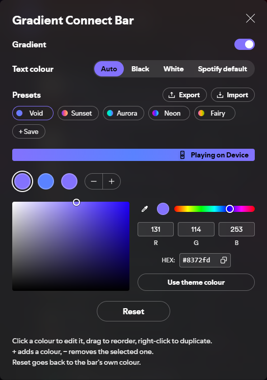

# Gradient Connect Bar

A [Spicetify](https://spicetify.app) extension that recolours Spotify's **Connect bar** — the "Playing on …" strip below the player while audio plays on another device — with one colour, or several blended into a gradient.

> **Status:** released — **v1.0.0**. See the [changelog](CHANGELOG.md) and the [roadmap](ROADMAP.md).



## Features

- **Solid colour or gradient**: start with one colour, add more and the bar becomes a gradient. The gradient spans the whole bar.
- **Up to 8 colours**, edited in a built-in colour picker with R/G/B and hex input, and reordered by drag-and-drop.
- **Theme colour**: a colour that follows your theme's accent instead of a fixed value. With themes that change their accent per song (like Hazy's album-art mode), the bar follows along.
- **Text colour**: *Auto* picks black or white text, whichever stays more readable over every colour behind it. Or choose *Black*, *White*, or *Spotify default* to leave the text alone. You judge the result in the preview.
- **Presets**: five built-in gradients (Void, Sunset, Aurora, Neon, Fairy), the same as Gradient Progress Bar's, and up to 12 of your own, with a preview and Undo.
- **Share codes**: copy your settings as a short code (`gcb1:…`) and paste someone else's. Codes from Gradient Progress Bar (`gpb1:…`) work too, so a gradient can move between the two bars.
- **Preview strip**: the bar only exists while you play on another device, so the settings show what it will look like.
- **Leaves everything else alone**: only the Connect bar changes. It runs side by side with [Gradient Progress Bar](https://github.com/VoidCrowned/spicetify-gradient-progress-bar), each with its own settings.

## Installation

**Spicetify Marketplace:** search for **Gradient Connect Bar** and click *Install*.

**Manual:**

1. Download `gradientConnectBar.js` from the [latest release](https://github.com/VoidCrowned/spicetify-gradient-connect-bar/releases/latest).
2. Copy it into the `Extensions` folder inside your Spicetify config folder (`spicetify config-dir` shows where), then enable it:
   ```sh
   spicetify config extensions gradientConnectBar.js
   spicetify apply
   ```

To uninstall: `spicetify config extensions gradientConnectBar.js-` then `spicetify apply`.

## Usage

Open the settings in any of these ways:

- **The top-bar button** with the brush icon. If Gradient Progress Bar is installed too and shares it (from its next version), the two extensions use **one** button, labelled *Gradient bars*, which opens a small menu with both; with only one of them it opens that one's settings straight away.
- **The profile menu**: *Gradient Connect Bar*.
- **Right-click the Connect bar**. The bar is only there while audio plays on another device.
- `__gcb.openSettings()` in the devtools console ([how to open it](TESTING.md#opening-the-devtools-console)).

In the settings:


- **Text colour** (below the Gradient switch): **Auto** (the default) looks at the colours behind the "Playing on …" text and picks black or white, whichever has the better contrast at the *worst* spot, so a dark patch behind light text can't hide. **Black** and **White** force that colour; **Spotify default** leaves the text as Spotify and your theme colour it.
- **Click a colour dot** to select it (it gets a ring) and edit it in the colour picker below the dots: drag in the square and the hue bar, use the eyedropper (where available), or type R/G/B values or a **hex code** (`#8372fd`, `8372fd` or `#87f`). The **copy icon** inside the hex field copies the colour as `#rrggbb`.
- **Use theme colour** makes the selected colour follow your theme's accent. Colours are always opaque.
- **Right-click a dot** for **Duplicate** and **Remove** (also with the context-menu key or Shift+F10).
- **Gradient** switches the gradient on and off. With only one colour, switching it on adds a second colour (a copy of the first) for you to change.
- **− | +** (the pill after the dots): **+** adds a copy of the last colour; **−** removes the selected one. Up to 8 colours; at least one always stays.
- **Delete** or **Backspace** on a colour dot you've tabbed to removes that colour.
- **Drag the dots** to reorder the gradient. With the keyboard, Alt + arrow keys move the focused colour (Alt + Home / End to the first or last place).
- **Presets** (below Text colour): click a chip to preview it. The strip shows it, text colour included, and the chip asks *Apply?*; click it again to apply. Escape or clicking elsewhere cancels; clicking another chip previews that one instead. After applying, *Undo* is there for 10 seconds. The built-ins only change the colours and keep your text colour; your own presets bring back everything they saved, the text colour included.
- **+ Save** stores the current settings as your own preset: type a name and press Enter (Escape cancels). **Right-click your own preset** (or use the context-menu key) to **Rename** it, **Update** it to the current colours, or **Delete** it (with Undo).
- **Export** copies a short code for the current settings to the clipboard; the button shows *Copied* with a check. **Import** opens a field: paste a code and the strip previews it; press Enter or *Apply* to use it, and you can Undo it. Codes from Gradient Progress Bar bring their colours and keep your text colour.
- **Reset** goes back to the default: a single colour that follows your theme, which leaves the bar its own colour, and *Auto* text. It asks for a second click to confirm.

With a single colour that follows your theme, the bar keeps its own colour.

## Compatibility

Designed to sit on top of any theme without fighting it: it uses no `!important`, never changes the bar's size, shape or theme variables, and only targets the Connect bar.

| | Notes |
|---|---|
| [Hazy](https://github.com/Astromations/Hazy) | The theme colour follows Hazy's accent, whether that's the album-art colour or your *Custom color*. |
| [Gradient Progress Bar](https://github.com/VoidCrowned/spicetify-gradient-progress-bar) | Runs alongside: separate settings, separate stylesheet, no overlap. Shares one top-bar button (from its next version), the five built-in presets, and share codes in both directions. |

## Troubleshooting

- **There's no Connect bar to right-click:** it only appears while audio plays on another device (your phone, a speaker, the web player). Use the top-bar button or the profile menu instead.
- **No top-bar button or profile-menu entry** on Spotify 1.3.4 or later with Spicetify 2.45.3 or earlier: two Spicetify bugs hide them ([spicetify/cli#4012](https://github.com/spicetify/cli/issues/4012) for the profile menu; the top bar's fix isn't in a release yet). This extension hides its menu entry on purpose while that bug is present, so it never breaks your profile menu. The author's separate [spicetify-fixes](https://github.com/VoidCrowned/spicetify-fixes) works around both (read its README first); otherwise right-click the bar or use `__gcb.openSettings()`.
- **Two brush buttons in the top bar:** Gradient Progress Bar 1.6.1 and earlier still has its own button. They share one from its next version.
- **After a Spotify update the bar is back to normal:** updates remove Spicetify's patch. Run `spicetify apply`, or `spicetify backup apply` if Spicetify asks for it.
- **Something looks wrong with your theme or another extension:** [open an issue](https://github.com/VoidCrowned/spicetify-gradient-connect-bar/issues/new/choose) and follow [CONTRIBUTING.md → Reporting a bug](CONTRIBUTING.md#reporting-a-bug).

## Roadmap

See [ROADMAP.md](ROADMAP.md) and the [changelog](CHANGELOG.md).

## Contributing

Bug reports and pull requests are welcome; see [CONTRIBUTING.md](CONTRIBUTING.md) and [TESTING.md](TESTING.md).

## Credits

- [Spicetify](https://spicetify.app)
- [Hazy](https://github.com/Astromations/Hazy) by Astromations — the theme this was built and tested against.
- Built on the code of [Gradient Progress Bar](https://github.com/VoidCrowned/spicetify-gradient-progress-bar).

## Licence

Copyright © 2026 VoidCrowned. This program is free software. It comes without any warranty, to the extent permitted by applicable law. You can redistribute it and/or modify it under the terms of the Do What The Fuck You Want To Public License, Version 2, as published by Sam Hocevar. See [LICENSE](LICENSE) or http://www.wtfpl.net/ for more details.
